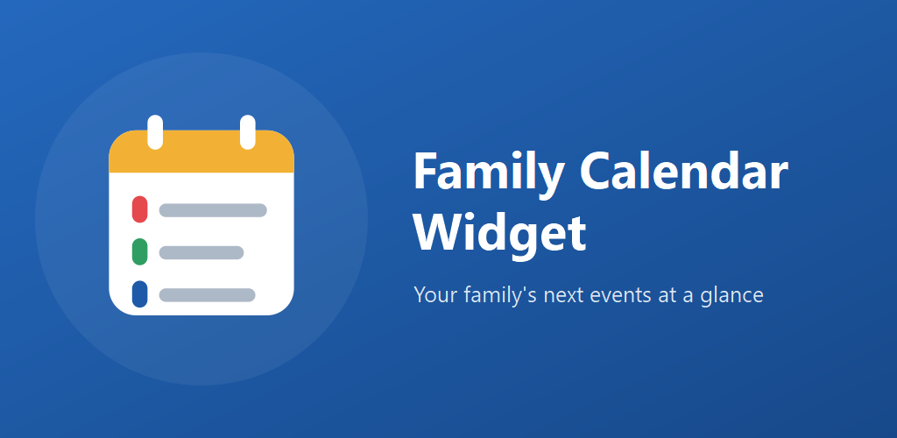
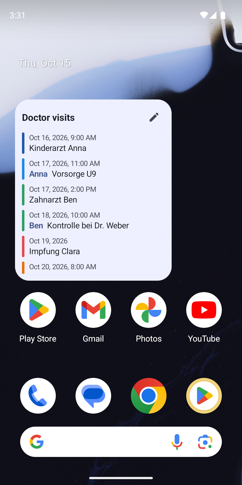
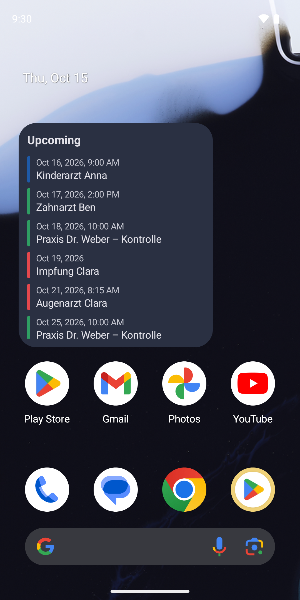
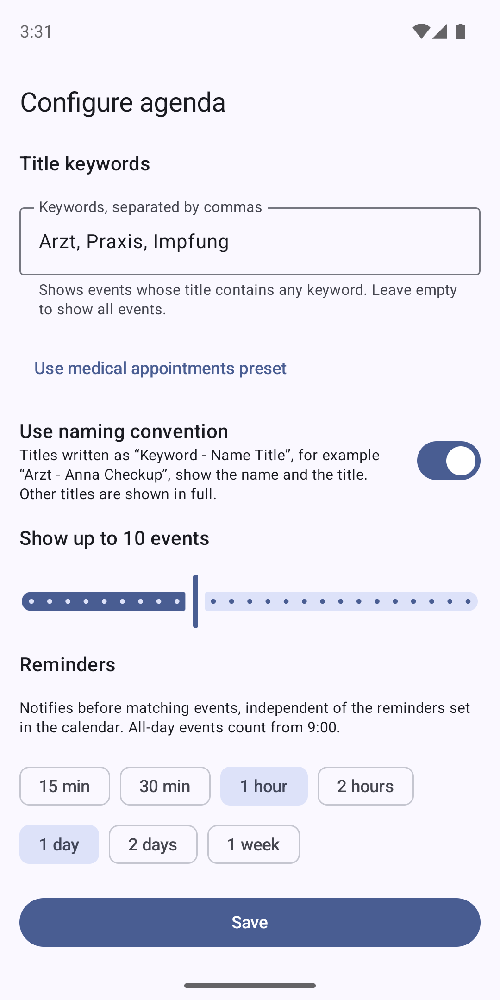
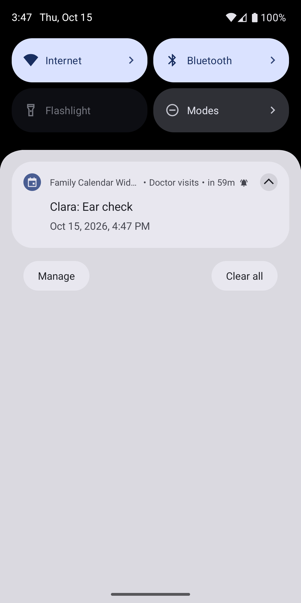
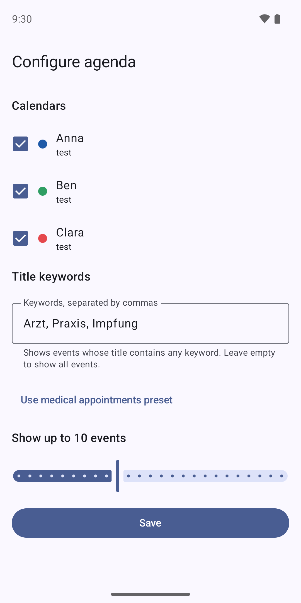
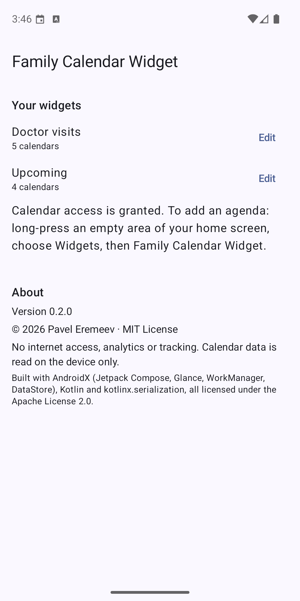

  

<h1 align="center">Family Calendar Widget</h1>

  <b>The appointments that matter, right on your home screen.</b> 
  Pick your family's calendars, choose what to show, and never miss the next doctor's visit again.

  
  
  
  
  

  
  
  
  

---

## ✨ Why

Family calendars get busy: school, sports, birthdays, and somewhere in between the appointments you really can't miss. **Family Calendar Widget** turns the calendars already on your phone into small, focused lists on your home screen. One widget for the kids' doctor visits, another for school, one more for the whole family. Each shows only what you asked for.

## 🧩 What it does

| | |
| --- | --- |
| 📅 **Your calendars, combined** | Works with every calendar on your phone (Google, Nextcloud and more). Choose several per widget, neatly grouped by account. |
| 🔎 **Only what matters** | Build your own filter: title, description or location contains, starts with or is exactly a word or matches a pattern, limited to the next days if you like, combined with all, any or none. Or use the ready-made preset for doctor's appointments. |
| 🧱 **As many widgets as you like** | Every widget has its own name, calendars, filter and length. Save filters as profiles and calendar selections as groups to reuse them. |
| 👤 **Who is it for?** | Write titles like `Doctor - Anna Check-up` and the widget shows **Anna** with *Check-up*: the keyword is for filtering, the name stands out. |
| 🔔 **Reminders, your way** | Get notified 15 minutes to a week ahead, separately for each widget and independent of the reminders in your calendar. Pop-up with sound or silent, as you like. |
| ✏️ **Edit in place** | Tap the pencil on the widget to change it, or manage all widgets in the app. Tap the plus to add an event: pick the person, and the title such as `Doctor - Anna Check-up` is filled in for you in your calendar app. |
| ⚡ **Always up to date** | Changes in your calendar show up within seconds; past events disappear on their own. |
| 🎨 **Your look** | Light, dark or system theme, an accent color, a color per person, the weekday at a glance, adjustable transparency, past events greyed out if you like, a compact view and a day-by-day layout, per widget. |
| 🌗 **Feels at home** | Resizable, follows your wallpaper colours, English and German. |

## 🚀 Get started in three steps

1. **Install** the app and allow it to read your calendars.
2. **Add the widget**: long-press your home screen → *Widgets* → *Family Calendar Widget*.
3. **Choose** calendars, filter and reminders, then tap *Save*. Done.

  
  

## 🔒 Private by design

- **No internet access at all.** The app cannot send your data anywhere.
- **No ads, no tracking, no analytics.**
- Events are read on your phone when needed and never stored by the app.
- Reminders on the lock screen only say *"Upcoming event"*, never the title.

Read the full [privacy policy](https://diddlik.github.io/family-calender-widget/privacy/).

## 📲 Get the app

Family Calendar Widget is in **closed testing on Google Play**. Android 8.0 or newer is required.

  

1. **Ask to join:** send the email address of your Google account to [digiwo@gmail.com](mailto:digiwo@gmail.com?subject=Family%20Calendar%20Widget%20tester). Only invited accounts can take part in the test.
2. **Accept the invitation:** open the [tester link](https://play.google.com/apps/testing/io.github.diddlik.calendarwidget) with that account and tap *Become a tester*.
3. **Install** the app from Google Play. Updates arrive automatically like for any other app.

## 🗺️ What's next

- ✍️ Creating events right inside the app (today the plus opens your calendar app)

See the [roadmap](docs/ROADMAP.md) for details.

## 🛠️ For developers

Built with Kotlin, Jetpack Compose and Jetpack Glance. Build commands, permissions, platform limits and the test checklist are in [docs/DEVELOPMENT.md](docs/DEVELOPMENT.md); the release pipeline is described in [docs/RELEASE.md](docs/RELEASE.md).

## 📄 License

[MIT](LICENSE) © 2026 Pavel Eremeev
